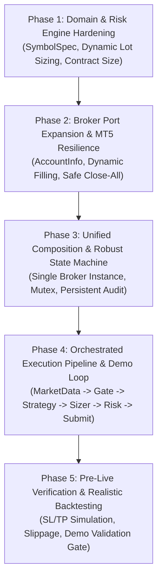

# WFL Trading MVP — Architecture & Risk Review

**Author**: Lead Architecture Reviewer  
**Date**: 2026-11-17  
**Scope**: Read-only Architecture & Risk Assessment of WFL Trading MVP  
**Target Environment**: Safe Demo MVP (MT5 Desktop Terminal pending installation) prior to any Live capital deployment.

---

## Executive Summary

The WFL Trading MVP repository provides an initial foundation featuring a Clean Architecture layout, a deterministic `InMemoryBroker`, an `MT5Broker` adapter for Windows, a baseline `RiskEngine`, and a FastAPI operator interface with diagnostics lab and dashboard.

However, the system currently contains **critical safety gaps, financial calculation risks, and broken state wiring** that would lead to severe order rejection, miscalculated trade sizing, or stuck states if run against a live MT5 terminal. Most crucially:
1. **Financial Sizing & Contract Size Omission**: Trade risk calculations omit instrument contract specifications (e.g. 100 oz/lot for Gold / XAUUSD), causing trade risk to be underestimated by **100x**.
2. **Split-Brain Broker Instances**: The FastAPI runtime creates two decoupled broker instances (`TradingService` on `InMemoryBroker` and `broker_lab` on `build_broker()`), meaning dashboard operator controls do not govern the actual MT5 broker adapter.
3. **Hardcoded Order Filling & Fragile Execution**: MT5 order submission and closing hardcode `ORDER_FILLING_IOC` without checking broker-supported execution modes, which triggers immediate rejections (`10030 / TRADE_RETCODE_INVALID_FILL`) on standard retail CFD/Forex brokers.
4. **Execution Void**: Strategy signals, market quality checks, risk validation, and broker submission operate as disjoint islands with no connecting orchestration pipeline or automatic sizing engine.

---

## 1. P0 / P1 / P2 Gaps and Risks

| ID | Priority | Category | Finding / Gap | Risk / Impact |
| :--- | :--- | :--- | :--- | :--- |
| **P0-1** | **P0** | **Financial / Risk** | **Contract Size & Tick Value Omission in `RiskEngine`**<br>`risk = abs(entry - stop_loss) * quantity` assumes 1:1 price-to-currency units. Omits `contract_size` (e.g., 100 for XAUUSD, 100,000 for FX). | **Severe capital exposure**: Underestimates XAUUSD risk by 100x. An approved 1.0 lot order with a $10 stop risks $1,000, not $10, completely blowing past the 0.25% equity limit. |
| **P0-2** | **P0** | **Architecture / State** | **Split-Brain Dual Broker Instances**<br>`api.py` instantiates `service = TradingService(InMemoryBroker())` and `broker_lab = build_broker_lab()` separately. | **Control disconnect**: Emergency `Close All` via `/control/close-all` clears the in-memory broker while open MT5 broker positions remain uncontrolled in the market. |
| **P0-3** | **P0** | **Risk / Execution** | **Lack of Dynamic Account & Equity Polling**<br>No adapter method queries `mt5.account_info()`. Dashboard hardcodes `equity=0`, `daily_loss=0`, `drawdown=0`. | **Risk engine blindness**: Daily loss (3%) and drawdown (5%) caps cannot function because account equity and floating PnL are never tracked. |
| **P0-4** | **P0** | **Execution / Safety** | **Hardcoded `ORDER_FILLING_IOC` in `MT5Broker`**<br>Hardcoded in both `submit()` and `close_all()` without querying `symbol_info.filling_mode`. | **Execution failure**: Most Forex/Gold brokers reject IOC orders with retcode 10030 (`TRADE_RETCODE_INVALID_FILL`), preventing both entry and emergency exit. |
| **P0-5** | **P0** | **Safety / Recovery** | **Fail-Partial in `MT5Broker.close_all`**<br>Loop iterates over positions and raises `RuntimeError` immediately on first failure. | **Catastrophic liquidation failure**: If position 1 fails to close (e.g., requote, off quotes), the loop aborts, abandoning all subsequent positions during emergency liquidation. |
| **P0-6** | **P0** | **Risk / Sizing** | **Absence of Position Sizing Engine**<br>No service translates `Signal` (entry, stop_loss) into `OrderRequest.quantity` based on allowable 0.25% dollar risk and broker lot step (`volume_step`, `min_volume`). | **Trading blocker**: Without an automated sizing engine, signals cannot be safely converted into executable orders. |
| **P1-1** | **P1** | **Pipeline** | **Disjoint Trading Pipeline (Execution Void)**<br>`MarketDataPort`, `MomentumStrategy`, `MarketDataQualityGate`, `RiskEngine`, and `TradingService` are uncoupled. | **Inability to trade**: No runner/worker coordinates fetching candles, filtering quality, computing signals, sizing orders, and dispatching trades. |
| **P1-2** | **P1** | **Reliability** | **Tick `None` Crashes on Market Close / Disconnect**<br>`mt5.symbol_info_tick(symbol)` returns `None` during market breaks or disconnects; calling `.ask` raises unhandled `AttributeError`. | **Server 500 crash**: Crashes operator endpoints and recovery procedures when market is inactive. |
| **P1-3** | **P1** | **State Machine** | **State Inconsistency & Orphaned `FAULTED` State**<br>Unhandled exceptions during `close_all` leave state stuck in `CLOSE_ALL_IN_PROGRESS`. `FAULTED` state is defined but never reached. Direct mutations in `api.py` bypass `TradingService`. | **System deadlock**: A failed close-all permanently locks the service out of resuming or recovering without manual server restart. |
| **P1-4** | **P1** | **Audit / Observability** | **In-Memory SQLite Audit Log & Missing Schema Timestamps**<br>`api.py` initializes `AuditRepository(":memory:")`. Table schema lacks `timestamp` / `created_at`. | **Compliance / Post-mortem failure**: All operational events vanish on restart; records cannot be correlated to market timestamps. |
| **P1-5** | **P1** | **Configuration** | **Ad-hoc `.env` Parsing vs Unified Config**<br>`api.py` reads `.env` with naive string splitting at request time (`_local_env()`), out of sync with `bootstrap.py` and `os.environ`. | **Config drift / Fragility**: Fails if running directory changes; credentials checked in multiple inconsistent ways. |
| **P1-6** | **P1** | **Market Data** | **`MT5MarketData` Ignores Method Timeframe & Selection**<br>`latest()` ignores the passed `timeframe: str` parameter, relying on `self.timeframe: int`. Fails if symbol is not selected via `symbol_select(symbol, True)`. | **Data fetch failure**: Inability to request multi-timeframe candles dynamically; silent failures on unselected symbols. |
| **P2-1** | **P2** | **Validation** | **Toy Backtester Uncoupled from Risk Realities**<br>`MomentumBacktester` trades every candle, ignores stop losses, ignores risk engine caps, and models zero spread/slippage. | **False validation signal**: Backtest results are deceptive and unrepresentative of live execution performance. |
| **P2-2** | **P2** | **Strategy** | **Hardcoded Fixed Stop Distance (`10.0`)**<br>`MomentumStrategy` hardcodes `stop_distance: 10.0`. Valid only for a subset of gold quotes; invalid for FX (negative prices) and negligible for BTC. | **Asset inflexibility**: Cannot support additional pairs or adaptive volatility (ATR). |
| **P2-3** | **P2** | **Quality Gate** | **Timeframe Coupling in Market Quality Gate**<br>`max_age_seconds: 120` hardcoded; rejects legitimate H1 or D1 historical bars. | **False rejections**: Limits quality checks strictly to 1-minute candle streaming. |
| **P2-4** | **P2** | **Code Hygiene** | **Dead Code & HTML Duplication in `api.py`**<br>`DASHBOARD_HTML` string is embedded in `api.py` while endpoints load `dashboard.html` from disk. | **Maintenance clutter**: Confuses template editing and bloats memory. |

---

## 2. Architecture Critiques

### 2.1 Strengths
- **Clean Port Abstractions**: Ports defined in `trading/domain/ports.py` (`BrokerPort`) and `market_data.py` (`MarketDataPort`) provide a strong Clean Architecture foundation.
- **Defensive Stop-Loss Enforcement**: `OrderRequest` model enforces mandatory stop-loss validation at the Pydantic boundary (`BUY stop_loss < entry`, `SELL stop_loss > entry`).
- **Safe Out-of-the-Box Defaults**: System defaults to `InMemoryBroker` when `TRADING_BROKER` is unset, protecting developers from accidental broker connections.
- **Module Injection in `MT5Broker`**: `MT5Broker(config, module=...)` allows full mockability and deterministic testing without a live Windows terminal.
- **Read-Only Diagnostics Lab**: Clear separation of connection testing in `/broker/lab` with credential masking prevents credential exposure over HTTP.

### 2.2 Core Structural Flaws & Coupling
1. **Split Composition Root**:
   - `bootstrap.py` provides `build_broker()`, but `api.py` ignores it for `TradingService`, hardcoding `TradingService(InMemoryBroker())`.
   - `api.py` serves multiple conflicting roles: HTTP controller, composition root, state mutator, and file-based config parser.
2. **Missing Broker Capabilities in Port**:
   - `BrokerPort` defines `connect`, `submit`, `close_all`, and `reconcile`.
   - It is missing `get_account_snapshot()` and `get_symbol_spec(symbol)`. Because these are absent, the application cannot obtain account balance, equity, margin, or lot specifications from the broker adapter.
3. **Imputed Fake Stop-Loss in Reconciliation**:
   - In `MT5Broker.reconcile()`: `stop_loss = raw.sl or raw.price_open`.
   - If an open position lacks a stop loss in MT5, the adapter fabricates a stop loss at `price_open`. This corrupts risk models and presents an illusory "safe" state to the operator.

### 2.3 Concurrency, State Machine & Resilience
- **Lack of Concurrency Synchronization**: `TradingService` and `api.py` have no mutex locks (`threading.Lock` / `asyncio.Lock`). Concurrent web requests (e.g. `/control/pause` while an order is processing) create race conditions.
- **Brittle State Transitions**:
  ```python
  service.state = SystemState.CLOSE_ALL_IN_PROGRESS
  closed = service.broker.close_all()  # If this raises RuntimeError...
  service.state = SystemState.PAUSED   # ...this line never executes!
  ```
  The system remains trapped in `CLOSE_ALL_IN_PROGRESS`. Proper architecture requires `try ... except Exception: service.state = SystemState.FAULTED`.

---

## 3. Dependency-Ordered Implementation Plan



### Phase 1: Domain & Risk Engine Hardening
*Dependencies: None (Pure Domain & Models)*

1. **Task 1.1: Introduce Instrument Specification Model (`SymbolSpec`)**
   - Add `SymbolSpec(symbol, contract_size, volume_step, min_volume, max_volume, tick_size, tick_value)`.
   - For XAUUSD: `contract_size=100.0`, `volume_step=0.01`, `min_volume=0.01`.
2. **Task 1.2: Refactor `RiskEngine` to Support Real Contract Sizing**
   - Update `RiskEngine.evaluate(order, account, symbol_spec)`:
     $$\text{monetary\_risk} = \frac{|\text{entry} - \text{stop\_loss}|}{\text{tick\_size}} \times \text{tick\_value} \times \text{quantity}$$
     *(or $|\text{entry} - \text{stop\_loss}| \times \text{contract\_size} \times \text{quantity}$ for USD-quoted pairs)*.
   - Clarify per-trade risk (0.25%) vs aggregate open risk policy.
3. **Task 1.3: Position Sizing Calculator (`PositionSizer`)**
   - Implement sizing domain logic: calculate lot quantity from risk dollar cap and stop distance, rounded down to the nearest `volume_step`.
- **Acceptance Tests**:
  - `test_risk_engine_calculates_xauusd_contract_size()`: Verifies 1 lot with 10 pt stop on XAUUSD calculates $1,000 risk, properly rejecting it on a $10,000 account.
  - `test_position_sizer_rounds_to_lot_step()`: Verifies computed lots adhere strictly to `volume_step` (e.g. 0.02 lots).

---

### Phase 2: Broker Port Expansion & MT5 Adapter Resilience
*Dependencies: Phase 1*

1. **Task 2.1: Expand `BrokerPort` with Account & Symbol Queries**
   - Add `get_account_snapshot() -> AccountSnapshot` and `get_symbol_spec(symbol: str) -> SymbolSpec` to `BrokerPort`.
   - Implement both on `InMemoryBroker` and `MT5Broker`.
2. **Task 2.2: Dynamic Filling Mode & Symbol Selection in `MT5Broker`**
   - Query `symbol_info.filling_mode` and `execution_mode` to select `ORDER_FILLING_FOK`, `ORDER_FILLING_IOC`, or `ORDER_FILLING_RETURN`.
   - Ensure `symbol_select(symbol, True)` before requesting ticks or market data.
3. **Task 2.3: Safe `close_all` with Full Settlement & Tick Null Guards**
   - Protect tick lookups against `None` (return structured error or skip).
   - In `close_all()`: Iterate through all positions with individual `try/except`; accumulate successes and failures; do not abort prematurely.
- **Acceptance Tests**:
  - `test_mt5_broker_adapts_filling_mode()`: Verifies execution uses symbol-supported filling mode.
  - `test_mt5_close_all_continues_on_partial_failure()`: Mock failure on position 1; verify position 2 is still closed and partial failure reported.
  - `test_mt5_broker_handles_null_tick_gracefully()`: Asserts clean exception/handling when market is closed (`tick is None`).

---

### Phase 3: Unified Composition & Robust State Machine
*Dependencies: Phase 2*

1. **Task 3.1: Unify Broker Wiring in Composition Root**
   - Remove duplicate broker instantiation. `api.py` must consume a single shared broker instance produced by `bootstrap.py`.
   - Update `/dashboard/state` to query the unified broker and real account snapshot.
2. **Task 3.2: Thread-Safe State Machine & Fault Handling**
   - Introduce `threading.Lock` across state transitions.
   - Enforce state transitions: on unhandled exception in `close_all` or `submit`, transition to `SystemState.FAULTED`. Require explicit `recover()` to return to `PAUSED`.
3. **Task 3.3: Persistent Audit Repository with UTC Timestamps**
   - Update SQLite schema: `id INTEGER PRIMARY KEY, timestamp TEXT, action TEXT, detail TEXT`.
   - Use configurable disk-backed database file path rather than `:memory:`.
- **Acceptance Tests**:
  - `test_unified_broker_reconciled_across_api_and_service()`: Ensure `/control/close-all` and `/broker/close-all` act on identical state.
  - `test_state_machine_transitions_to_faulted_on_error()`: Inject broker exception and verify state becomes `FAULTED`.
  - `test_audit_persistence_and_timestamp_ordering()`: Verify audit log survives process re-instantiation and contains ISO8601 timestamps.

---

### Phase 4: Orchestrated Execution Pipeline & Demo Loop
*Dependencies: Phase 3*

1. **Task 4.1: Trading Execution Use Case (`ExecuteTradingCycle`)**
   - Connect the pipeline:
     1. Poll `MarketDataPort.latest()`.
     2. Evaluate `MarketDataQualityGate.evaluate()`.
     3. Evaluate `MomentumStrategy.evaluate()`.
     4. Calculate quantity via `PositionSizer`.
     5. Validate with `RiskEngine.evaluate()`.
     6. Dispatch to `TradingService.submit()`.
2. **Task 4.2: Expose Operator Cycle Endpoint & Guarded Polling**
   - Expose `POST /trading/step` (manual step for Demo validation) and optional controlled background worker with pause/resume hooks.
- **Acceptance Tests**:
  - `test_e2e_trading_cycle_from_market_data_to_position()`: Full flow test with `InMemoryBroker` verifying candle generation -> signal -> risk approval -> position opened.
  - `test_trading_cycle_aborts_when_quality_gate_fails()`: Verifies stale data halts execution before risk/strategy.

---

### Phase 5: Pre-Live Verification & Realistic Backtesting
*Dependencies: Phase 4*

1. **Task 5.1: High-Fidelity Backtester Engine**
   - Refactor `MomentumBacktester` to evaluate high/low candles against Stop Loss and Take Profit levels, deducting realistic spreads and slippage.
2. **Task 5.2: Pre-Live Validation Guardrails**
   - Require minimum 50 clean Demo trades with 0 unhandled exceptions before approving configuration for Live trading.
- **Acceptance Tests**:
  - `test_backtester_triggers_stop_loss_on_candle_wick()`: Verify trade terminates on intra-candle low rather than closing price.

---

## 4. Recommended First Implementation Slice

### Target: Phase 1 (Domain Risk Sizing & Contract Specifications) + Single Broker Unification

**Objective**: Eliminate the 100x financial risk miscalculation and resolve the dual-broker split-brain bug before touching MT5.

**Scope of Changes**:
1. **`src/trading_mvp/models.py` & `src/trading_mvp/trading/domain/models.py`**:
   - Add `SymbolSpec` model containing `contract_size`, `volume_step`, `min_volume`, `max_volume`, `tick_size`, and `tick_value`.
2. **`src/trading_mvp/risk.py`**:
   - Update `RiskEngine.evaluate(order, account, symbol_spec)` to calculate dollar risk with `symbol_spec.contract_size`.
   - Add `PositionSizer.calculate_lot_size(account, order_risk_pct, stop_distance, symbol_spec)`.
3. **`src/trading_mvp/api.py` & `src/trading_mvp/bootstrap.py`**:
   - Inject the single broker from `bootstrap.build_broker()` into `TradingService`. Ensure `api.py` references `service.broker` uniformly.
4. **Verification**:
   - Run `pytest tests/test_risk.py tests/test_trading_service.py` with added unit tests for contract sizing and split-brain resolution.
